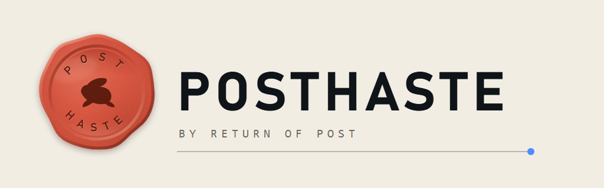

<p align="center">
  <picture>
    <source media="(prefers-color-scheme: dark)" srcset="resources/brand/brand-mark/lockup-dark.png">
    
  </picture>
</p>

<p align="center">
  <a href="https://github.com/Moler1995/posthaste/actions/workflows/ci.yml"></a>
  <a href="LICENSE"></a>
  
  
</p>

<p align="center">A fast, native API client built with Rust &amp; GPUI.</p>

Posthaste is a lightweight, local-first API client. Collections, requests, and
environments are plain JSON files you can commit and review, requests run
natively, and the whole app ships as one small binary — no account, no cloud,
no telemetry.

> **Status:** early (0.1.0). The HTTP and WebSocket request loop, collections,
> environments and variables, history, cookies, response viewer, imports, and
> session restore are implemented. See [ROADMAP.md](ROADMAP.md) for what is
> next.

## Contents

- [Features](#features)
- [Performance](#performance)
- [Download](#download)
- [Build from source](#build-from-source)
- [Documentation](#documentation)
- [Project layout](#project-layout)
- [License](#license)

## Features

- **Native HTTP and WebSocket** — real requests through reqwest and rustls, a
  collapsible JSON tree, raw text, headers, timing, size, and binary responses
  with save-to-file, save-to-Downloads, copy-as-base64, and a bounded
  view-as-text fallback. Text responses that the server names as a file offer
  the same two save actions.
- **Git-friendly workspace** — collections, folders, requests, environments,
  and uploaded files are plain JSON and files, written atomically with stable
  names.
- **Environments and variables** — `{{name}}` substitution in URLs, headers,
  query rows, and bodies, with completion, missing-value marks, and in-place
  assignment.
- **Request history** — every execution recorded outside the workspace, with
  sensitive headers redacted, replay into an unsaved draft, and a 500-entry cap.
- **Cookie jar** — automatic capture and attach, a dialog to inspect, add,
  remove, and clear, and one persisted jar per workspace.
- **Imports and exports** — Posthaste bundles, cURL text, and Postman
  Collection v2.0/v2.1, in both directions.
- **Session restore** — the next launch returns the open tabs, their drafts,
  and their presented responses.
- **Made to live in** — English and 简体中文, dark/light/system themes, configurable
  limits, and a compact native window.

## Performance

Posthaste is a native GPUI application: no browser engine or web runtime sits
between the process and the window.

| Scenario | Time |
| --- | --- |
| Launch with an empty workspace | **303 ms** (median of 10 launches, 296–314 ms) |
| First open of a 4,000-request workspace | **7.5 s** (7.4 s, 7.5 s, 7.6 s on three fresh copies) |
| Open of that workspace once indexed | **679 ms** (median of 10 launches, 664–709 ms) |

Times run from process creation to the app being ready for input. The window
frame appears earlier, while the workspace is still loading, so window
appearance is not used as the end point. The large workspace held 80
collections and 4,000 requests as plain JSON — 18 MB across about 4,100 files.
Its first open parses every request file and writes a per-workspace index;
later opens read the index and parse only what changed. In a first open the
process used about one second of CPU and read 8.6 MB, so most of the wait is
per-file I/O, most likely Windows Defender's on-access scanning.

Measured on an Intel Core i5-10400 (6 cores), 32 GB RAM, a SATA hard disk, and
Windows 10 (build 18363), on the `dist` release build. A cold start — the first
launch after a reboot or install, with the executable not in the file cache —
is not reported: flushing that cache reliably needs administrator rights, so it
cannot be measured from an ordinary shell.

Reproduce on your own machine with `pwsh scripts/bench-startup.ps1` for the
empty workspace, or add `-Workspace <path>` to open a workspace of your own
(`-Runs 1 -SkipWarmup` measures a first open). The script opens a temporary
workspace and redirects preferences, recents, and cookies, so it leaves no
state in your own; the one exception is the per-workspace request index, which
the app writes under the platform cache directory by design.

## Download

Prebuilt archives are attached to [GitHub Releases](https://github.com/Moler1995/posthaste/releases).
No release has been published yet; until the first one, build from source below.

The release archive is a portable Windows x86_64 zip containing
`posthaste.exe`, `README.md`, and `SHA256SUMS`. It needs no installer. The
executable is currently unsigned, so Windows SmartScreen may warn on first
launch; see [Signing status](CONTRIBUTING.md#signing-status).

## Build from source

Prerequisites: Rust 1.99.1 through rustup. On Windows the GNU host target and a
MinGW-w64 toolchain are required — the full per-platform list is in
[CONTRIBUTING.md](CONTRIBUTING.md#prerequisites).

```bash
git clone https://github.com/Moler1995/posthaste.git
cd posthaste
cargo build
cargo run -p posthaste-app
```

The first build compiles several hundred crates and takes roughly 5–10 minutes.
To build the distributable archive instead, run
`pwsh scripts/build-dist.ps1`; see [Building a release](docs/release.md).

## Documentation

| Document | Contents |
| --- | --- |
| [User guide](docs/guide.md) | Workspaces, storage, preferences, imports, variables, cookies, WebSocket sessions, response viewer, history, layout |
| [Contributing](CONTRIBUTING.md) | Prerequisites, commands, pull requests, required checks, release process, design tokens |
| [Platform support](docs/platform-support.md) | Per-platform status, the automated launch check, and the manual verification checklist |
| [Building a release](docs/release.md) | Portable archive, checksum verification, shader shim, icon regeneration |
| [Changelog](CHANGELOG.md) | Released and unreleased changes |
| [Roadmap](ROADMAP.md) | Current state and planned work |
| [Security policy](SECURITY.md) | Supported versions and private vulnerability reporting |
| [Code of conduct](CODE_OF_CONDUCT.md) | Community expectations and enforcement |
| [Upgrading gpui](docs/upgrading-gpui.md) | The UI framework upgrade checklist |

## Project layout

```
crates/
  posthaste-core/   # UI-free domain model, HTTP/WebSocket executor, storage
  posthaste-app/    # gpui views and the `posthaste` binary
docs/               # user guide, platform status, release build, gpui checklist
resources/          # brand assets, application icons, window glyphs
scripts/            # release archive, icon packers, startup benchmark
tools/fxc-shim/     # shader compiler for builds without the Windows SDK
```

The workspace is Rust 2024. HTTP uses reqwest with rustls; documents use serde
and JSON; the UI is [gpui](https://github.com/zed-industries/zed/tree/main/crates/gpui)
0.2.2.

## License

MIT — see [LICENSE](LICENSE).

Posthaste is not affiliated with Digital Rebellion's Post Haste or with
EasyPost.
